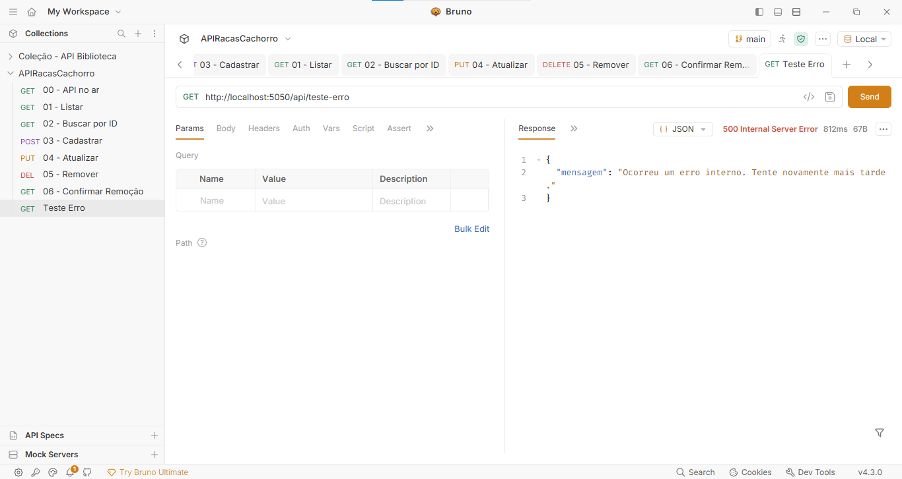
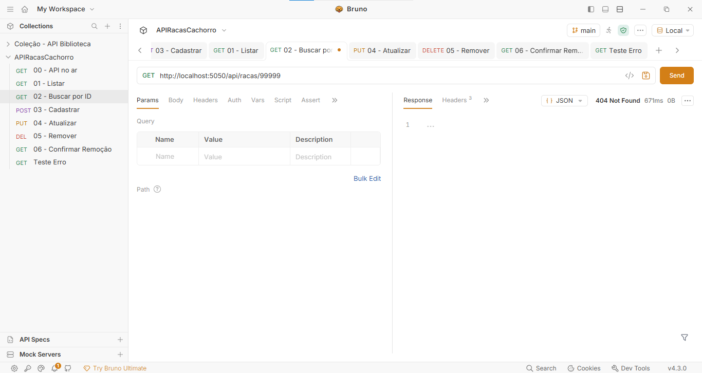
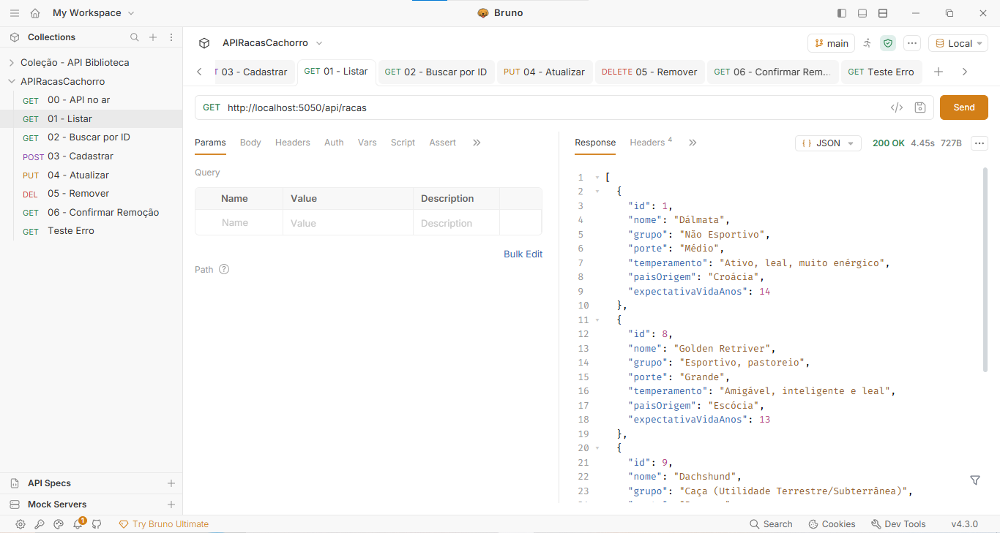

# Aula 14 — Erros, exceções e middleware

## 1. Onde o middleware foi colocado
No Program.cs, logo depois de `var app = builder.Build();` e antes de `app.UseStaticFiles();` e das rotas (`app.Map...`).

## 2. Teste temporário
- Método: GET
- Rota: /api/teste-erro
- Status: 500 Internal Server Error
- Corpo: {"mensagem":"Ocorreu um erro interno. Tente novamente mais tarde."}

A frase "Falha simulada para teste." não apareceu na resposta.

## 3. Teste de ID inexistente
- Método: GET
- Rota: /api/racas/99999
- Status: 404 Not Found (corpo vazio)

O middleware não transformou o 404 em erro 500. Uma rota normal (GET /api/racas) continuou respondendo 200.

## 4. Por que não enviar a mensagem bruta da exceção ao cliente
Não devemos enviar a mensagem bruta da exceção ao cliente porque ela pode revelar detalhes internos da aplicação, como caminhos de arquivos, consultas ao banco ou partes do código, e isso ajudaria uma pessoa mal-intencionada a atacar o sistema. O cliente só precisa saber que ocorreu um erro, e o diagnóstico detalhado deve ficar com a equipe técnica, em um lugar seguro.