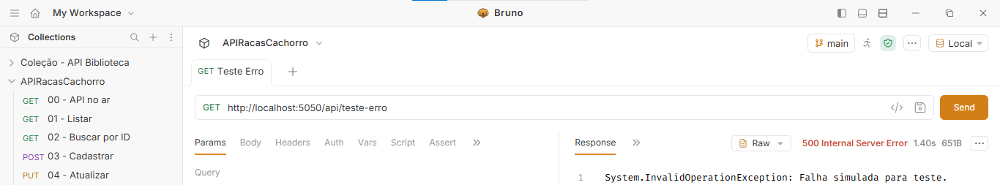
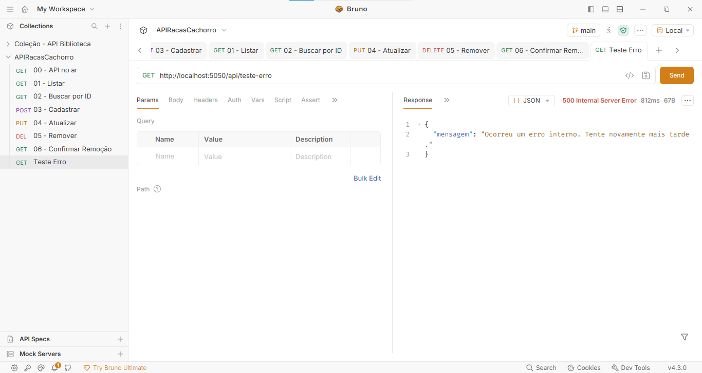

# Aula 15 — Erros, exceções e middleware

## Comparação: antes e depois do middleware

**Antes (sem middleware, em Development)**
- Método e rota: GET /api/teste-erro
- Status: 500 Internal Server Error
- O que a resposta revelou: a mensagem original da exceção ("Falha simulada para teste.") e o rastreamento técnico, incluindo o caminho do arquivo no computador.

**Depois (com middleware, em Production)**
- Método e rota: GET /api/teste-erro
- Status: 500 Internal Server Error
- Corpo: {"mensagem":"Ocorreu um erro interno. Tente novamente mais tarde."}

Um endpoint normal (GET /api/racas) continuou com 200, e um ID inexistente (GET /api/racas/99999) continuou com 404.

## Respostas do fechamento

**1. Por que um ID inexistente não deve virar exceção?**
Porque um dado não encontrado é um resultado previsto e comum no uso de uma API, e não uma falha do sistema. Por isso, quando o ID não existe, a API devolve 404 Not Found. Se esse caso virasse exceção, o middleware o transformaria em erro 500, o que indicaria uma falha inesperada que não aconteceu.

**2. Que informação não deve ser devolvida na mensagem pública?**
Não devem ser devolvidos detalhes técnicos internos da aplicação, como a mensagem original da exceção, o rastreamento da pilha, caminhos de arquivos do servidor, consultas ao banco de dados ou credenciais. No meu teste sem o middleware, a resposta mostrou o caminho do arquivo Program.cs no computador. Essas informações podem facilitar ataques e não ajudam o usuário. O cliente deve receber apenas uma mensagem genérica e segura, e a equipe técnica investiga a causa em um local seguro.

**3. Onde o middleware foi colocado?**
No Program.cs, logo depois de `var app = builder.Build();` e antes de `app.UseStaticFiles();` e das rotas (`app.Map...`). Nessa posição, ele envolve a execução dos endpoints e consegue capturar uma exceção que ocorra neles.